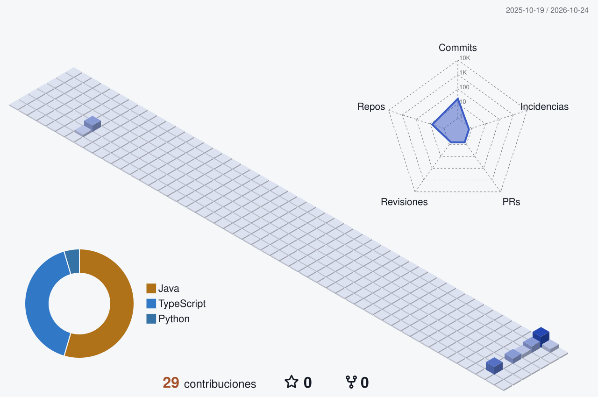

<!-- Perfil generado con galaxy-profile (github.com/vinimlo/galaxy-profile) y
     github-profile-3d-contrib (github.com/yoshi389111/github-profile-3d-contrib).
     Las imágenes viven en assets/generated/ y profile-3d-contrib/ y se
     regeneran solas mediante el workflow .github/workflows/generate-profile.yml
     (cron cada 12 h) leyendo config.yml. -->

  <picture>
    <source media="(max-width: 600px) and (prefers-color-scheme: light)" srcset="./assets/generated/galaxy-header-mobile-light.svg">
    <source media="(max-width: 600px)" srcset="./assets/generated/galaxy-header-mobile.svg">
    <source media="(prefers-color-scheme: light)" srcset="./assets/generated/galaxy-header-light.svg">
    
  </picture>

 

  

 

  <b>TELEMETRÍA DE LA MISIÓN</b>

  <picture>
    <source media="(max-width: 600px) and (prefers-color-scheme: light)" srcset="./assets/generated/stats-card-mobile-light.svg">
    <source media="(max-width: 600px)" srcset="./assets/generated/stats-card-mobile.svg">
    <source media="(prefers-color-scheme: light)" srcset="./assets/generated/stats-card-light.svg">
    
  </picture>

 

  <b>STACK TECNOLÓGICO</b>

  <picture>
    <source media="(max-width: 600px) and (prefers-color-scheme: light)" srcset="./assets/generated/tech-stack-mobile-light.svg">
    <source media="(max-width: 600px)" srcset="./assets/generated/tech-stack-mobile.svg">
    <source media="(prefers-color-scheme: light)" srcset="./assets/generated/tech-stack-light.svg">
    
  </picture>

 

  <b>PROYECTOS DESTACADOS</b>

  <picture>
    <source media="(max-width: 600px) and (prefers-color-scheme: light)" srcset="./assets/generated/projects-constellation-mobile-light.svg">
    <source media="(max-width: 600px)" srcset="./assets/generated/projects-constellation-mobile.svg">
    <source media="(prefers-color-scheme: light)" srcset="./assets/generated/projects-constellation-light.svg">
    
  </picture>

 

<strong>Más sobre mí</strong>

 

Estudiante de Ingeniería en Sistemas de Información en la Universidad de Sonora (Hermosillo, Sonora, México).

Desarrollo aplicaciones en Java con bases de datos y sockets, y me gusta entender lo que cada cliente necesita antes de escribir la primera línea de código.

 

  
  

 

  <b>CRÉDITOS</b>

 

  
    Perfil construido sobre dos proyectos de código abierto: 
    <a href="https://github.com/vinimlo/galaxy-profile">galaxy-profile</a>, de
    <a href="https://github.com/vinimlo">vinimlo</a> — licencia GPL-3.0. 
    <a href="https://github.com/yoshi389111/github-profile-3d-contrib">github-profile-3d-contrib</a>, de
    <a href="https://github.com/yoshi389111">yoshi389111</a> — licencia MIT. 
    Consulta <a href="./THIRD_PARTY.md">THIRD_PARTY.md</a> para el texto completo de las licencias.
  

